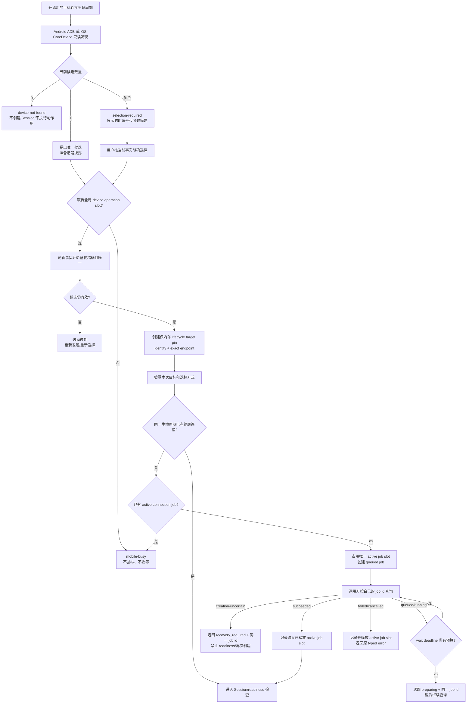
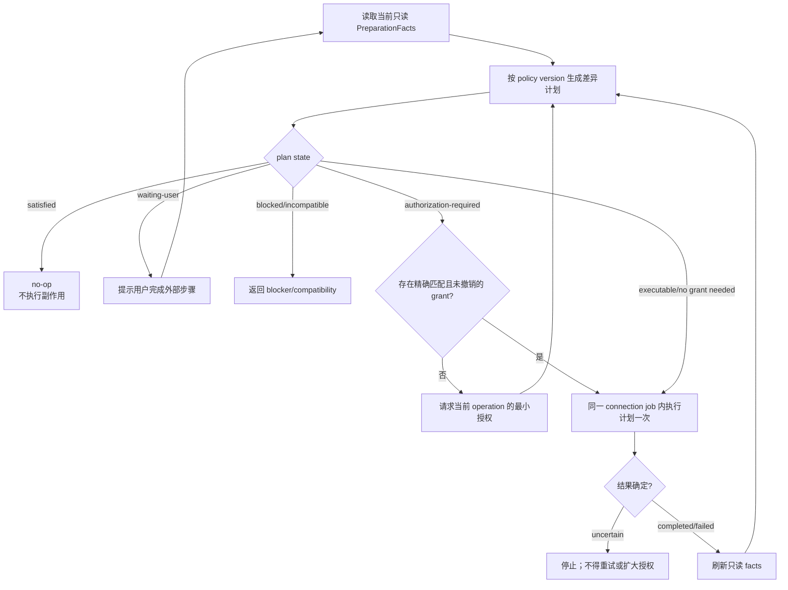
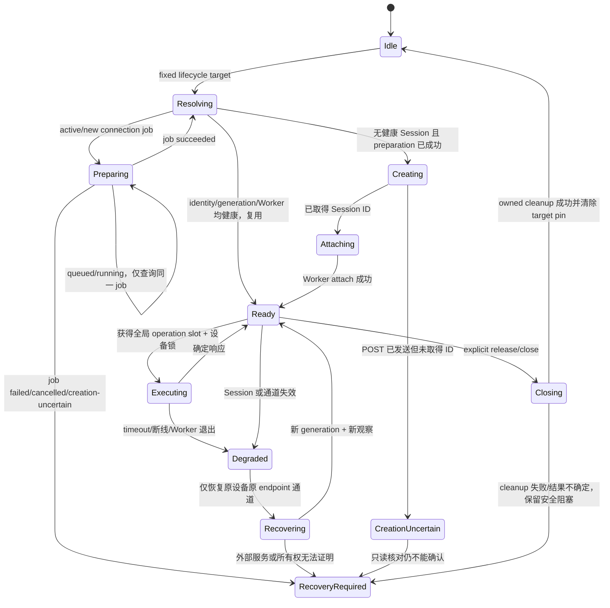
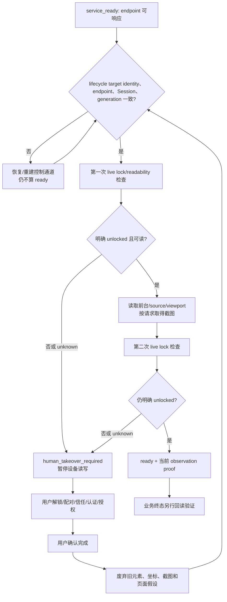
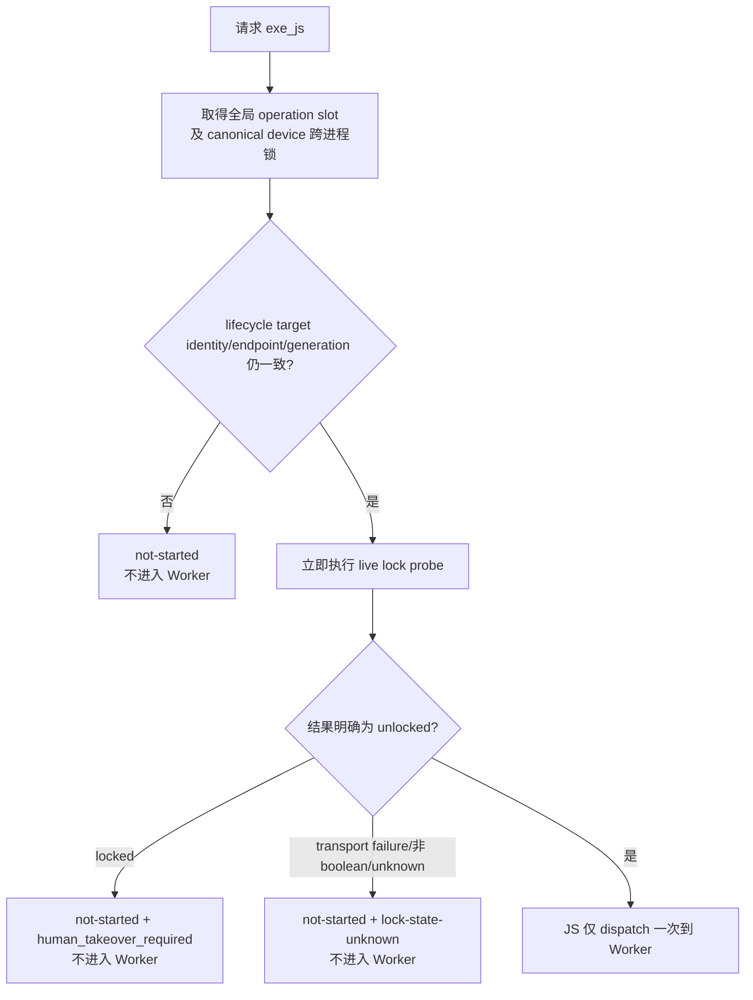
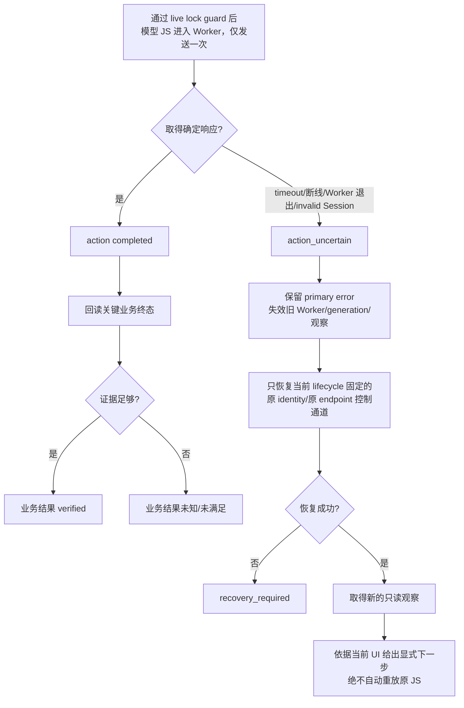

# Maat MVP 设备管理与连接管理重建设计

> 状态：设计已按 PROD-006 修订确认；部分 G1 合同已实装，G1 尚未完成
>
> 范围：Android / iOS 设备发现、生命周期目标选择、连接、Appium Session、就绪与恢复
>
> 基线：以 iPhone-use 的可观察行为、状态、错误和安全语义为参考，不复制其实现  
> **删除声明：仅删除本轮新引入且隔离的 `BindingStore` 属于已确认的 G1 修订范围；共享旧 resolver、legacy hints 解释、macOS backend 和其他旧实现仍须保留到本文所列 Gate 通过并取得显式删除授权。本文不授权广泛删除。**

## 1. 一页摘要

### 对齐目标

- 从头建立一致的设备身份、生命周期目标选择、连接任务、Session、所有权和 readiness 模型。
- Android 与 iOS 对外使用相同状态和错误语义；平台差异留在 provider / policy 内。
- 发现只提供当前事实；零候选失败，唯一候选可为本生命周期自动选择并清楚披露，
  多候选必须由用户明确选择。active 生命周期固定精确 identity 与 endpoint；
  断线、缺失或 endpoint 变化均不换机、不 fallback，成功 release/close 后忘记目标。
- MVP 不支持并发：同一进程/工作区全局仅一个 active connection job 和一个 device operation；冲突立即返回 `mobile-busy`，不排队。
- 复用健康且身份完全一致的 Session；连接恢复只恢复控制通道，不重放可能已执行的动作。
- `service_ready`、设备 `ready`、动作完成和业务成功分别表达；`ready` 必须带当前设备观察证据。
- 人工处理解锁、配对/信任、Developer Mode、签名、账号登录和 App 认证；恢复后重新观察。

### 非目标

- 不复制 iPhone-use 的 iOS-only direct-WDA、固定工具、跨进程 Session 收养或“工具拥有服务”假设。
- 不替换跨平台 Appium 路线，不改变“模型生成 JavaScript，经 `exe_js` 在现有 Worker 执行”的产品路径。
- 不让 Maat 默认管理、重启或停止用户管理的 Appium、ADB、WDA 或 UiAutomator2。
- 不新增第二套 Agent、Worker、Case、Evidence 或 Runner。保留现有 Worker 与截图 observation helper；已移除的正式 Case/Evidence store/Runner 继续保持移除。
- macOS 不属于本轮设备管理重建范围，但它仍是共享 Appium 路径的现有消费者；迁移期间必须保持其旧 backend 和兼容入口可用。
- 不自动解锁、认证、接受授权、改签名、清 App 数据、卸载 App 或切换设备。
- 不保存用户／工作区默认设备，不提供“记住此设备”，不跨进程恢复或收养目标选择。
- MVP 跨进程锁不排队，不运行 broker/daemon，不建立 durable ownership、crash
  quarantine 或手动恢复系统，也不共享或收养 job/Session。
- 不把本设计写入视为已实装、已通过测试或已完成真机验证。

### 关键决策

1. 采用受约束的 Strangler 迁移，而非删除 `platforms/appium` 整目录后一次性重写。
2. `DeviceIdentity` 是稳定路由身份；显示名不是身份。发现、生命周期选择与 Session
   target pin 彼此分离，target 不落盘、不跨 release/close 或进程重启。
3. Maat Session、外部 Appium 服务和平台 automation backend 分别记录所有权。
4. Session 默认只在创建它的 Maat 进程内复用；不照搬 iPhone-use 的跨进程 Session 收养。
5. 只有明确只读的内部探测可按预算重试；任意 JS 一旦进入 Worker，失败按可能已执行处理，绝不自动重放。
6. 新路径首版只覆盖本地 Android 物理机与本地 iOS 物理机；emulator/simulator、
   远程 Appium 与 macOS 均不在本轮新迁移范围，既有兼容路径继续受保护。
7. G1 修订可移除本轮新增且隔离的 `BindingStore`；共享旧路径仍先冻结合同并逐段切流，
   G5 与 G5M 通过后提交精确批量删除清单，再取得一次显式删除授权。

## 2. 设计原则与职责边界

调用方向保持为：

```text
Pi tools / standalone Maat
  -> MaatApi
  -> PlatformRegistry / PlatformAdapter facade
  -> internal mobile ports
  -> Android or iOS provider + Appium session backend
  -> existing killable Worker
```

- `MaatApi`、`PlatformAdapter` 和 Pi tool wire contracts 仍是公开边界；Pi 不直接导入内部连接类。
- Appium 是跨平台传输和 Session backend；设备发现和 readiness 不能反向依赖 Host SDK。
- Appium 服务生命周期与设备 Session 生命周期分离。`release_device_session` 只释放已证明由 Maat 创建的 Session。
- Worker 只 attach 到 parent 创建的 Session，继续承载超时、Abort、输出限制和动作不确定性。
- `evidence.screenshot()` 仍只是内存图片 observation，不引入持久 Evidence store。
- 错误现场采集只能增加只读诊断；诊断或 cleanup 失败不得覆盖 primary error，也不得用自动动作改变现场。
- stable ID、Session ID、UI Tree、截图和日志均按敏感运行数据处理；不得写入 Git，展示和日志默认脱敏。

## 3. 目标模块结构与职责

以下是目标逻辑边界；路径名称可在实施评审时微调，职责不可重新混回单体 resolver。

```text
packages/core/src/mobile/
  contracts/
    device.ts             DeviceIdentity / 当前候选与选择合同
    connection.ts         ConnectionJob / typed errors
    session.ts            SessionIdentity / generation
    ownership.ts          ResourceOwnership
    readiness.ts          ReadinessState / observation proof
  devices/
    inventory.ts          聚合只读发现事实
    target-selector.ts    当前候选快照、选择验证与脱敏披露
    coordinator.ts        MVP 全局 operation slot、跨进程设备锁、选择竞态排斥
    android-provider.ts   ADB 发现与只读状态
    ios-provider.ts       CoreDevice 发现与只读状态
  connection/
    job-supervisor.ts     connection job 创建、查询、超时和取消
    endpoint-policy.ts    精确 endpoint；禁止隐式 fallback
  preparation/
    planner.ts            只读 facts 与目标状态生成差异计划
    policy.ts             平台动作、兼容性、授权与禁止项判定
    grant-store.ts        当前 job 内可撤销、按 artifact/policy 限定的授权
    executor.ts           经授权后由 connection job 执行一次计划
  session/
    session-plan.ts       纯函数生成固定 device/endpoint/capabilities
    lifecycle-owner.ts    仅内存 target pin 与 release/close 忘记语义
    session-manager.ts    同生命周期 create/reuse/generation/close 状态机
    appium-provider.ts    WebdriverIO/Appium 创建与 Worker attach
  readiness/
    probe.ts              身份、锁状态、source、viewport、截图证明
    takeover.ts           人工接管暂停与恢复后失效旧观察
  lifecycle/
    cleanup.ts            仅清理 owned resource，聚合 cleanup error
```

| 模块                        | 负责                                                        | 不负责                                    |
| --------------------------- | ----------------------------------------------------------- | ----------------------------------------- |
| `DeviceInventory`           | 只读枚举、归一化平台事实                                    | 选中、持久化目标、启动服务                |
| `SessionTargetSelector`     | 临时候选引用、零／单／多候选决策、当前事实重验证和披露      | 写磁盘、推定多候选同意、授权动作          |
| `LifecycleOwner`            | 仅内存 target pin、active lifetime、成功关闭后忘记          | 跨进程收养、默认设备、掩盖 close failure  |
| `DeviceCoordinator`         | 进程/工作区全局 operation slot、跨进程设备锁、`mobile-busy` | 排队、跨进程共享 job/Session              |
| `ConnectionJobSupervisor`   | 本进程/工作区唯一 active job、按 job ID 查询和终态清理      | 跨进程发布/收养 job、设备锁、Session 清理 |
| `PreparationPlanner/Policy` | 读取事实、计算 no-op/blocker/差异动作和授权需求             | 创建 Session、持有 job、直接执行副作用    |
| `PreparationGrantStore`     | 校验和保存可撤销、最小范围授权                              | 扩大授权范围、保存凭据、推定用户同意      |
| `PreparationExecutor`       | 在一个 connection job 内按已批准计划执行一次并刷新事实      | 自动重试 uncertain 动作、管理 Session     |
| `SessionPlan`               | 固定 lifecycle target、capabilities、权限                   | discovery fallback                        |
| `SessionManager`            | Session 创建、复用、generation、关闭                        | 重启用户 Appium 服务                      |
| `ReadinessProbe`            | 当前设备只读证明及 observation                              | 业务成功判定                              |
| 平台 provider/policy        | ADB/CoreDevice 和平台准备差异                               | 改变公共状态语义                          |

## 4. 核心类型

下列为设计合同，不表示当前代码已经导出这些类型。

```ts
type MobilePlatform = 'android' | 'ios';

type DeviceIdentity = {
  platform: MobilePlatform;
  providerInstanceId: string; // MVP 为 local-adb / local-core-device 固定实例
  routingId: string; // Android serial 或 iOS UDID
  kind: 'device' | 'emulator' | 'simulator';
  transportScope: 'local-adb' | 'core-device';
  displayName?: string; // 只用于展示，不参与身份相等
};

type SessionTargetSelection = {
  lifecycleId: string;
  identity: DeviceIdentity;
  endpointId: string;
  selectedBy: 'single-candidate' | 'explicit-user-selection';
  disclosure: {
    candidateCount: number;
    redactedTargetLabel: string;
  };
};

type CandidateReference = {
  discoveryId: string; // 短期、仅内存的发现快照
  candidateNumber: number; // 只在该快照内有意义
};

type ConnectionJob = {
  id: string;
  endpointId: string;
  deviceKey: string;
  operation: 'prepare' | 'recover';
  state: 'queued' | 'running' | 'creation-uncertain' | 'succeeded' | 'failed' | 'cancelled';
  resources: ResourceOwnership;
  startedAt: string;
  deadlineAt: string;
  errorCategory?: string;
};

type SessionIdentity = {
  endpointId: string;
  canonicalDeviceKey: string;
  platform: MobilePlatform;
  generation: number;
  backend: 'appium';
  internalSessionHandle: string; // 内部 Appium Session ID，不进入公开结果或日志
  creator: {
    processInstanceId: string;
    processStartIdentity: string;
    ownerToken: string;
  };
};

type OwnershipRecord =
  | {
      state: 'maat-owned';
      resourceId: string;
      proof: 'owner-token' | 'child-process-token';
    }
  | { state: 'externally-managed'; manager: 'user' | 'appium' | 'provider' }
  | { state: 'uncertain'; reasonCode: string; lastKnownProof?: string };

type ResourceOwnership = {
  appiumService: OwnershipRecord;
  appiumSession: OwnershipRecord;
  automationBackend: OwnershipRecord; // WDA / UiAutomator2
};

type PreparationOperation =
  | 'install-ios-wda'
  | 'resign-ios-wda'
  | 'connect-appium-automation-backend'
  | 'restart-user-appium'
  | 'reboot-ios-device'
  | 'deploy-android-helper';

type PreparationFacts = {
  deviceKey: string;
  platform: MobilePlatform;
  capturedAt: string;
  artifactFingerprint?: string;
  policyVersion: string;
  blockers: string[];
  compatibility: 'compatible' | 'incompatible' | 'unknown';
  facts: Record<string, string | boolean | number | null>;
};

type PreparationPlan = {
  deviceKey: string;
  factsFingerprint: string;
  artifactFingerprint?: string;
  policyVersion: string;
  state: 'satisfied' | 'waiting-user' | 'authorization-required' | 'executable' | 'blocked';
  operations: PreparationOperation[];
  blockers: string[];
  compatibility: PreparationFacts['compatibility'];
};

type PreparationGrant = {
  id: string;
  deviceKey: string;
  operation: PreparationOperation;
  artifactFingerprint: string;
  policyVersion: string;
  scope: 'current-job';
  jobId: string;
  grantedAt: string;
  revokedAt?: string;
};

type PreparationResult = {
  deviceKey: string;
  operation: PreparationOperation;
  artifactFingerprint?: string;
  policyVersion: string;
  state: 'satisfied' | 'completed' | 'waiting-user' | 'blocked' | 'uncertain' | 'failed';
  blockers: string[];
  compatibility: PreparationFacts['compatibility'];
  refreshedFactsFingerprint?: string;
  errorCategory?: string;
};

type SessionState =
  | 'idle'
  | 'resolving'
  | 'preparing'
  | 'creating'
  | 'creation-uncertain'
  | 'attaching'
  | 'ready'
  | 'executing'
  | 'degraded'
  | 'recovering'
  | 'closing';

type ReadinessState =
  | { state: 'unconfigured' }
  | { state: 'preparing'; jobId: string }
  | { state: 'service_ready' }
  | {
      state: 'human_takeover_required';
      reason: 'locked' | 'pairing' | 'trust' | 'developer-mode' | 'signing' | 'authentication';
    }
  | { state: 'ready'; session: SessionIdentity; observationId: string }
  | { state: 'recovering'; jobId?: string }
  | { state: 'recovery_required'; reason: string }
  | { state: 'failed'; category: string };
```

约束：

- 新生命周期先读取当前候选事实：零候选不创建 Session 或执行准备副作用；唯一候选可自动选择，
  但须在首次准备副作用、Session 创建或设备动作前披露目标及单候选原因；多候选必须取得
  用户对当前候选的明确选择。用户主动给出的描述只有在当前事实中唯一匹配时才构成明确选择。
- `CandidateReference` 仅引用短期内存快照，不是 identity。选择在全局 device operation slot
  内按当前事实重新验证；快照过期、候选变化或不再唯一时返回 `selection-required`，不得猜测。
  显示名只用于展示，不能单独决定目标。
- 选择验证成功并创建内存 target pin 时，Mobile Session／连接生命周期开始。其 active lifetime
  覆盖 preparation、Session create/reuse、readiness、人工接管等待、同目标 recovery，直到
  成功 release/close。模型 turn 结束或短暂断线不结束生命周期。
- `SessionTargetSelection` 仅属于当前进程的当前生命周期，不写磁盘。成功 release/close 后清除；
  release/close 失败或不确定时不得声称 closed/forgotten，应保留必要的进程内 safety/cleanup
  阻塞状态。进程重启不恢复 target、不收养旧 Session，新生命周期重新 discovery 和选择。
- active 生命周期固定完整 identity 与精确 endpoint。设备缺失、断线或 endpoint 变化只允许恢复
  原 identity 与原 endpoint；失败则 fail closed，不 fallback、不 remap、不开始新选择。换目标须
  成功 close/release 后创建新生命周期，不存在 MVP `rebind`。
- `endpointId` 必须是版本化、规范化的精确路由 key，而不是显示标签；G1 冻结其等值字段和
  配置更新规则。该合同冻结前，任何同名、重解析或地址变化都不得推定为原 endpoint。
- 旧 `{kind,name}` 等 Session hints 只是兼容输入，不是选择、同意或授权。共享旧 hints 可按
  既有兼容路径缓存或持久化为受 Gate 保护的兼容配置／匹配输入；仅当它们与当前事实精确且
  无歧义匹配时可缩小当前候选方案，不能替用户完成多候选选择。不得将 hints 持久化或恢复为
  生命周期 target selection、target pin、consent、authorization、default device、readiness
  或 `BindingStore` 数据。MVP 没有 `DeviceBinding`／`BindingStore` 目标合同。
- 目标选择不授权 preparation 或手机动作，不表示 service ready、device ready、动作完成或业务成功。
- identity equality 是 `platform + providerInstanceId + routingId + kind` 的逐字段相等；`displayName` 和当前连接状态不参与。`canonicalDeviceKey` 是该元组的版本化、无歧义编码；本地 provider instance 使用稳定常量，日志只记录其脱敏摘要。
- MVP 使用一个进程/工作区全局 active job slot，不按 endpoint、设备或 operation 分槽；已有 active job 时，新启动请求返回 `mobile-busy`。调用方只能按自己获得的 job ID 查询；等待超时不创建第二个 job。`creation-uncertain` 是独立非终态。
- 跨进程只按 `canonicalDeviceKey` 的私密派生值获取本机、非阻塞的设备级 OS/process-lifetime
  锁来防止碰撞；锁跨 workspace、项目和 VS Code Session 生效。最终候选重验证成功后、
  lifecycle target pin 前获取，覆盖整个 active lifecycle；成功 release/close 后释放，
  close 失败或结果不确定时由存活进程继续持有，进程退出或崩溃时由 OS 自动释放。锁冲突
  立即返回 `mobile-busy`，不得建立 target pin、创建 Session、执行 preparation 或手机动作，
  也不得泄露锁持有者或设备 key。锁名称、路径、日志和错误不得包含或可逆编码原始设备
  identity。进程之间不共享/收养 job、Session ID、generation、Worker 或 active slot。
- `connectionKey = endpointId + canonicalDeviceKey` 的多槽 single-flight 仅保留为未来并发扩展方向，不属于 MVP 合同或验收。
- `SessionIdentity` 相等要求 lifecycle target 的 endpoint、canonical device、platform、backend 和
  generation 全部一致；内部清理由 session handle 和 creator identity 证明，公开结果必须脱敏。
- 三类资源分别记录 ownership；任一 `uncertain` 都会停止该资源的自动 cleanup/restart，但不会把其他资源的 ownership 一并升级或降级。
- preparation 可在每次连接前只读检查，但只有当前 facts 不满足 plan 时才产生有副作用 operation；facts 已满足必须返回 `satisfied`/no-op。
- MVP grant 只在当前 job 内复用，必须精确匹配 `jobId + deviceKey + operation + artifactFingerprint + policyVersion` 且未撤销；不持久化 `matching-artifact` 授权。
- `artifactFingerprint` 是版本化摘要：安装/重签包含实际 artifact 与签名输入；重启等无安装包操作使用触发该 operation 的配置/兼容性 facts 摘要，不以空值形成宽泛授权。
- `ready` 必须引用同一 generation 上新取得的 source、viewport 与按请求取得的截图；它不代表业务成功。

## 5. 状态机与关键流程

### 5.1 发现、生命周期目标选择与 MVP 全局单任务



- 唯一 active job slot 在 `queued` 前、任何副作用前占用；`queued`、`running`、`creation-uncertain` 均保持占用，只有终态记录完成后释放。wait deadline 只结束本次等待。
- 同一调用方可按 job ID 查询自己的 job；其他启动请求只得到 `mobile-busy`，不得获得、共享或收养 active job。终态结果按 job ID 有界保留。
- `check_device_ready` 的 job wire 已冻结：启动不带 `jobId`，可在既有启动字段上增加
  `waitSeconds`；查询使用 `{jobId, waitSeconds}`（`jobAction` 省略或为 `query`）；取消使用
  `{jobId, jobAction:"cancel", waitSeconds}`。`waitSeconds` 范围为 0–20 秒，只限制本次等待，
  不改变 job 的固定连接截止时间。带 `jobId` 时禁止携带截图、WDA 授权或目标选择等启动字段。
- job ID 是 CSPRNG 生成的不透明 bearer，不含设备、时间或 endpoint 信息。unknown、foreign
  和已过期 ID 统一返回 `connection-job-not-found`，且不会回退为启动。终态脱敏快照仅存进程
  内存，完成后保留 10 分钟且最多 32 条（任一限制先到即移除）；查询不续期。active 与
  `creation-uncertain` 不淘汰，进程退出后全部丢失。
- device operation 使用另一个进程/工作区全局 slot，覆盖目标选择的最终重验证、create、
  execute、close 和 readiness；冲突同样立即 `mobile-busy`，不排队。候选编号与
  `discoveryId` 只存在内存中，不能跨刷新或重启解释。
- 跨进程仅对目标 `canonicalDeviceKey` 获取非阻塞设备锁；锁不传播 job/Session 状态，冲突也返回 `mobile-busy`。任何进程都不得收养另一进程的 job 或 Session。
- target pin 建立后只允许同一生命周期复用。目标掉线、缺失或 endpoint 改变时，
  只恢复原 identity／endpoint；不得重新进入候选流程。换目标必须先成功 release/close，
  再创建新生命周期。成功关闭清除 target pin；关闭失败或不确定则保留安全阻塞状态，
  不得声称已忘记或允许新动作。

### 5.2 平台准备：事实、差异计划与授权



`PreparationPlanner` 每次都可检查；检查本身不授权安装、重签、重启或部署。只有事实不满足且 policy 生成差异 operation 时，executor 才可能执行副作用。operation 由 MVP 唯一 active `ConnectionJob` 承载，但 planner、policy、grant store 不并入 `ConnectionJobSupervisor`，executor 也不创建或复用 Appium Session。

授权复用规则：

- MVP 仅支持 `current-job`：精确匹配 `jobId + deviceKey + operation + artifactFingerprint + policyVersion`，job 结束即失效，不持久化跨 job grant。`matching-artifact` 是未来扩展，不在 MVP 类型、存储或验收范围内。
- 换设备、Team、artifact/build、profile、certificate、bundle、Appium driver 或 policy version 变化，当前 plan/grant 立即失效并重新授权。
- operation 结果为 `uncertain` 或 grant 已撤销时不得复用；先停止并刷新事实，不能自动重放。动作成功后依靠 refreshed facts 得出 `satisfied`，后续检查直接 no-op，因此无需再次询问。
- 安装授权不能升级为重签、重启、业务 App 安装、清数据或其他 operation；每项单独规划和授权。

平台策略：

- **iOS**：WDA 首装只在目标设备缺少匹配安装时规划 `install-ios-wda`；重签只在签名事实不匹配时规划 `resign-ios-wda`，两者授权不互通。`connect-appium-automation-backend` 表示请求用户管理的 Appium 创建/连接 WDA，由 Appium 管理 backend，不表示 Maat 拥有或可停止 WDA。用户管理 Appium 需要重启时只返回 `waiting-user` 的 `restart-user-appium`，Maat 不执行；物理设备重启是独立 `reboot-ios-device`，默认等待用户操作，不能由安装/重签授权推导。
- iOS artifact fingerprint 至少覆盖 WDA build/source revision、provisioning profile UUID/expiry、certificate identity/expiry、Team ID、目标 device inclusion、WDA bundle ID 和 Appium/XCUITest driver compatibility。任一字段变化、过期、device 不再包含、bundle/profile 不一致或 compatibility 变为 unknown/incompatible，旧 plan/grant 失效并重新读取事实。
- **Android**：每次可只读检查 ADB online/authorized/target identity、Appium/UiAutomator2 driver compatibility，以及 helper/package/version facts。仅当 UiAutomator2/helper 缺失或版本不兼容时规划 `deploy-android-helper`；普通连接失败、Session/脚本错误或 readiness 暂时失败不得触发重复部署。Maat 不自动启动或重启 ADB daemon、用户 Appium 或物理设备。

所有权始终分离：用户管理的 Appium service 是 `externally-managed:user`；它创建/连接的 WDA 或 UiAutomator2 是 `externally-managed:appium`；只有取得内部 handle 与 creator proof 的 Appium Session 才是 `maat-owned`。准备计划和 grant 都不能改变该归属。

### 5.3 Session 创建、复用与 ownership uncertain



复用前必须同时满足：

1. Session 属于当前 active lifecycle，target canonical identity 与 endpoint 精确一致；
2. Session generation 是当前 generation；
3. parent Session 和 attached Worker 均健康；
4. 没有进行中的 selection/close/recover；
5. readiness 可在当前设备重新证明。

成功 release/close 后 target pin 与复用资格一并失效；新生命周期不得复用上一生命周期、
上一进程或仅由历史 Session ID 指示的 Session。release/close 失败或结果不确定时，
不得报告 closed/forgotten，也不得因而创建另一目标的 Session。

`POST /session` 超时属于独立的 job/session `creation-uncertain`，MVP active job slot 继续占用。此时禁止再次 `POST /session`、对未知 Session 执行 DELETE、声称 cleanup 成功，或把 Appium/WDA/UiAutomator2 升级为 Maat-owned；只能由原进程用同一 job 做有界只读核对，直到确认已有 Session、确认未创建，或由用户显式处理。其他进程不得收养。Maat 默认将 Appium service 记为 externally-managed、Appium Session 在取得 handle 和 creator proof 后记为 maat-owned、WDA/UiAutomator2 记为 Appium-managed。

### 5.4 Readiness 与人工接管



人工接管期间不自动操作设备。若任务仍需手机，可保留健康 Session，但不得读写；恢复后先创建新 observation，旧元素 ID、坐标和截图全部失效。

### 5.5 每次动作前的 live lock guard

每次物理 Android/iOS 的 `exe_js` 都按可能包含 mutation 处理；缓存的 readiness 不能替代紧邻 dispatch 的 live guard。



live lock probe 的 transport failure、无法解析或非 boolean 结果一律是 `unknown`，不得显示为 ready，也不得进入 Worker。guard 与动作不是设备端原子操作，不能完全消除检查后瞬时锁屏的竞争；若 dispatch 后失联，仍进入下节的 `action_uncertain`，不能假定动作未发生。

### 5.6 不确定动作恢复



只有执行前的 discovery、status、lock 和不含旧 element ID 的内部只读探测可在同一 deadline/budget 内重试。Maat 无法可靠静态判断任意 JS 是否只读，因此整个 JS execution 永不自动重试。
recovery 不创建新的目标选择；原 identity 缺失或原 endpoint 变化／不可恢复时 fail closed，
返回 `recovery_required`。使用其他目标或 endpoint 必须成功 release/close 后开始新生命周期。

## 6. Android 与 iOS 差异

| 主题           | Android                                                                              | iOS                                                                                     | 统一合同                                                                |
| -------------- | ------------------------------------------------------------------------------------ | --------------------------------------------------------------------------------------- | ----------------------------------------------------------------------- |
| 稳定身份       | local-adb 实例 + ADB serial                                                          | local-core-device 实例 + 物理机 UDID；CoreDevice identifier 仅作发现事实                | MVP 仅本地 provider；identity equality 使用完整命名空间元组             |
| 设备类型       | physical / emulator                                                                  | physical / simulator                                                                    | target identity 保留 kind，不能混选                                     |
| 发现           | 只读查询既有 ADB daemon，不自动启动                                                  | CoreDevice 为主；不以 `xctrace` 作为新主身份源                                          | 只提供当前候选事实；不持久化选择、不创建 Session                        |
| 准备事实       | ADB online/authorized、helper/package/version、Appium/driver compatibility           | pairing/trust、Developer Mode、build/profile/cert/Team/device/bundle/driver fingerprint | 每次可只读检查；事实满足即 no-op，unknown 不执行副作用                  |
| 自动化 backend | UiAutomator2，通常由 Appium 管理                                                     | XCUITest/WDA，通常由 Appium 管理                                                        | backend 可响应不等于设备 ready                                          |
| 服务所有权     | ADB daemon 与 Appium service 默认 externally-managed；UiAutomator2 为 Appium-managed | Appium service 默认 externally-managed；WDA 为 Appium-managed                           | service/session/backend 分别记录；未证明 ownership 不 stop/restart/kill |
| 准备副作用     | 仅 helper 缺失/不兼容才部署；普通连接/脚本错误不部署；不重启 ADB/Appium/设备         | WDA 首装、重签、Appium 连接 backend、用户 Appium 重启、设备重启分别规划                 | 一个 job 只执行一次；uncertain 不重试                                   |
| 授权复用       | 当前 job 内精确匹配 device/operation/helper artifact/policy                          | 当前 job 内精确匹配 device/operation/WDA signing artifact/policy                        | 仅 current-job；成功后 refreshed facts=satisfied，跨 job 不持久化授权   |
| readiness 证据 | 精确 serial、两次锁检查、source、viewport、可选截图                                  | 精确 UDID、两次锁检查、source、viewport、可选截图                                       | 同一 Session generation 的 live 证据                                    |
| 恢复           | 不重启外部 ADB/Appium，不切换 serial                                                 | 不从端口推断 owner，不自动重启外部 Appium/WDA                                           | 只恢复控制通道，不重放动作                                              |

屏幕预览与控制通道独立：无预览帧不必然表示控制失败，缓存画面也不能作为当前 readiness 或业务结果证据。

## 7. 旧实现保留、替换与删除边界

**不能直接整目录删除。** `packages/core/src/platforms/appium/` 同时包含设备解析、Session 所有权、Worker attach、截图和 runtime globals；整目录删除会跨越公开 API、执行安全和平台边界。

### 必须保留的合同/边界

- `MaatApi`、`PlatformAdapter`、`PlatformRegistry`、default registry 与 Pi tool wire contracts。
- 通用 Worker 协议、`JavaScriptSession`、输出/图片校验、超时/Abort、`actionState` 和 cleanup error 聚合。
- parent 创建并拥有 Appium Session、Worker attach、transport retry 为 0 的安全语义。
- Android 冷 ADB 只读 preflight；iOS CoreDevice 事实及签名/首次安装授权检查。
- Appium/WebdriverIO 路线、setup assistant、现有截图 observation helper。
- macOS adapter 对共享 `AppiumPlatformAdapter`、runtime、screenshot 和 schema 的现有消费；在 macOS 单独迁移前固定走旧 backend。
- 已移除 Case/Draft/正式 Evidence store/Runner 的负合同，以及只作历史资产的 `maat-tests/`。

### 由新端口逐步替换

- `session-resolver.ts` 中混合的 endpoint、设备选择、fallback、readiness 和 capability 编排。
- `runtime/manager.ts` 的对象内 `busy` 与隐式 Session 状态。
- `runtime/session.ts`、`exploration-runtime.ts` 的 Appium 具体接入可在保持 Worker/所有权合同时替换。
- `setup/devices.ts` 的混合平台发现，迁移到 Android ADB / iOS CoreDevice provider。
- name-only selector、隐式唯一设备替换、endpoint fallback、字符串前缀错误分类。
- WDA preparation 与 runtime ownership 的混合职责。
- 旧 Session hints 只保留兼容输入地位：它们不得形成 consent 或 durable target；
  精确且无歧义时最多缩小当前 proposal，并仍受零／单／多候选规则约束。

### G1 修订范围内可移除

- 本轮为旧持久绑定方案新增、与共享旧路径隔离的 `DeviceBinding`／`BindingStore`
  合同、实现及其专属测试。文档批准后可在 G1 合同修订中移除，无需等待 G5/G6；
  这不表示 G1 已完成，也不授权删除共享 resolver、旧 hints/macOS backend、
  compatibility facade 或任何已有消费者路径。
- 旧 binding 文件不得迁移为本生命周期的 target，也不得影响选择。实现切流前应忽略
  其选择语义；文件的最终清理需单独证明 ownership 和安全边界，不能盲删用户状态。

### 仅在最终 Gate 后可申请删除

- 已无消费者的重复设备选择和旧 resolver 路径。
- 当前生命周期目标缺失时自动替换、endpoint 不可用时 fallback 的旧行为。
- iOS `xctrace list devices` 作为主发现源的路径。
- 已被生命周期选择合同取代的旧 hints 解释规则。
- Session transport cleanup 中隐式 App terminate 行为，应改为调用方明确授权的 app lifecycle 操作。

最终删除清单必须按文件和 symbol 给出精确批量范围；先移除消费者，再删 provider，最后才收缩 schema/exports。G5 与 G5M 通过后对整份批量清单申请一次显式授权，不逐文件逐次询问；清单外内容不在授权范围。不得删除通用 Worker、公开 facade、SetupAssistant、历史 `maat-tests/`，也不得恢复或新建 Case/Evidence store/Runner。

共享文件只要仍有 macOS 或其他消费者，就必须保留 compatibility facade/re-export 及旧 backend；不得为完成 Android/iOS 清理而删除 provider。逐文件无消费者证明必须覆盖静态/动态 source import、macOS adapter、仓库内测试和已发布 package 入口，并通过现有 macOS 合同回归与 package smoke。

## 8. 迁移顺序与 Gate

| Gate            | 顺序与进入条件                | 退出证据                                                                                                                         |
| --------------- | ----------------------------- | -------------------------------------------------------------------------------------------------------------------------------- |
| G0 设计确认     | **已按 PROD-006 修订通过**    | 生命周期选择设计已获批；不表示已实装、G1 已完成或共享旧代码获删除授权                                                            |
| G1 合同测试     | **部分合同已实装，仍待完成**  | identity、零／单／多候选、临时引用重验证、生命周期 pin/forget、无磁盘 binding、进程内全局 busy、跨进程设备锁、ownership、防重放和负合同通过 |
| G2 新内部端口   | **新内部端口**                | facade 后建立 device selection/connection/preparation/session/readiness ports；公开 API 与 Pi wire shape 不变                    |
| G3 切只读路径   | **切只读路径**                | discovery、PreparationFacts、application inspection、endpoint status 按平台切换；不得创建 Session 或执行准备副作用               |
| G3P 切准备计划  | **G3 后、G4 前**              | planner/policy/grant store 接入；事实满足为 no-op，副作用由单一 connection job 执行一次，uncertain 不重试                        |
| G4 切 Session   | **切 Session**                | 按平台切 create/reuse、Worker attach、readiness、execute、close；同 lifecycle 固定 identity、endpoint 和 backend，成功关闭后忘记 |
| G5 真机验证     | **真机验证**                  | Android、iOS 分别完成下节矩阵；Mock、模拟端口或单一平台不能替代                                                                  |
| G5M macOS 保护  | **与 G5 并行、G6 前必须通过** | 若 macOS 未迁移则证明它仍固定使用旧 backend；保留 facade/re-export，并通过 source-import、现有 macOS 合同和 package smoke        |
| G6 批量删除授权 | **显式授权**                  | 提交无引用证明、精确到文件/symbol 的一份批量清单、回滚方案和已知限制；对整份清单取得一次批准                                     |
| G7 删除旧实现   | **删除旧实现**                | 仅删除 G6 批准的批量清单；仍有消费者则保留兼容入口。更新 exports/docs/package check，完整回归通过                                |

切流采用平台/能力开关；只能在动作开始前选择 backend，不能在 uncertain action 后 fallback
到旧 backend。legacy Session hints 只作兼容输入，不迁移到 `BindingStore`，不持久化或
静默重解释为用户选择。G1 可删除上述隔离的新 `BindingStore`，但 G5/G5M/G6/G7 继续保护
共享旧 resolver、hints 解释、macOS backend 和 compatibility 路径。

当前生命周期 release/close 切片的自动化证据绑定
`test/session-target-selection.test.ts` 与 `test/native.test.ts`：覆盖成功释放后重新 discovery、
旧候选引用失效、owned Session 一次 cleanup、cleanup 失败后的 fail-closed、创建不确定时不
DELETE 未知 Session、动作不重放，以及 legacy hints 写盘脱敏。该证据仅说明部分 G1 合同已
实装；不代表 G1 通过，不证明跨进程锁或后续 Gate，也不替代 Android／iOS 真机验收。

## 9. 验收标准与真机矩阵

### 自动化合同验收

1. 零候选不创建 Session 或执行准备副作用；唯一候选可为当前生命周期自动选择并在操作前
   披露；多候选必须由用户基于当前事实明确选择。临时候选引用在全局 operation slot 内
   重验证，显示名不是 identity；不存在持久 binding、默认设备或 MVP rebind。
2. identity equality 覆盖本地 provider instance 和 routing ID；远程 provider 不注册、不进入首版路径。
3. 进程/工作区已有 active connection job 或 device operation 时，新启动请求立即 `mobile-busy` 且不排队；原调用方可查询自己的 job。跨进程设备锁冲突同样 busy，且不共享/收养 job 或 Session。
4. Session 仅在同一 active lifecycle 且 identity/endpoint/generation/Worker 全匹配时复用；
   release/close 或进程重启后不复用、不收养。创建超时使 job/session 进入独立
   `creation-uncertain`，不再次创建、DELETE 未知 Session 或升级资源 ownership。
5. preparation 每次检查；satisfied 为 no-op。只有 facts 不满足才执行一次差异动作，`uncertain` 不重试。
6. grant 仅为 current-job，严格匹配 job/device/operation/artifact/policy；不持久化跨 job 授权。成功后 refreshed facts=satisfied，变化、撤销或 uncertain 后重授权，且安装授权不能扩大。
7. iOS 首装、重签、backend 连接、用户 Appium 重启和设备重启分支独立；Android 普通连接/脚本错误不触发 helper 重部署，且两平台均不自动重启用户服务或设备。
8. `service_ready` 不可冒充 `ready`；locked/unknown 时不读取业务 UI、不发动作。
9. readiness 的 source、viewport 和可选截图属于同一 generation，锁状态前后检查。
10. readiness 成功后再锁屏或使 lock probe 返回 transport failure/非 boolean：每次 `exe_js` dispatch 前的 live guard 都阻止进入 Worker，`actionState=not-started`。
11. execute timeout、断线、invalid Session 或 Worker death 为 `action_uncertain`，连接层不重放 JS。
12. release/close 幂等，只删除有内部 handle、creator identity 和 ownership proof 的 Session；
    成功后清除内存 target pin。失败或不确定时不声称 closed/forgotten，保留安全阻塞；
    三类资源不混淆，cleanup failure 与 primary error 同时保留。
13. 公开 API、Pi tools、Worker IPC 保持兼容；Case/Evidence store/Runner 不被恢复；运行数据不进入仓库。
14. macOS 未迁移时继续使用旧 backend；共享文件保留 compatibility facade/re-export，macOS 合同与 package smoke 通过。
15. target selection 不写磁盘。legacy hints 仅在精确且无歧义时缩小当前 proposal，
    不构成多候选 consent、不跨 lifecycle，也不迁移到 `BindingStore`。

### 真机验收矩阵

以下全部是发布前计划，**当前未执行、未验证**。测试使用受控 App 和无敏感数据账号，不执行发送、购买、删除或认证等未授权操作。

| 场景                                            |                                             Android 物理机 |                                                          iOS 物理机 | 必备证据                                                                                                                                                                                         |
| ----------------------------------------------- | ---------------------------------------------------------: | ------------------------------------------------------------------: | ------------------------------------------------------------------------------------------------------------------------------------------------------------------------------------------------ |
| 单候选自动选择、披露、冷连接                    |                                                       必测 |                                                                必测 | 候选数、脱敏目标、选择方式、job id、状态转换                                                                                                                                                     |
| 多候选要求用户明确选择                          |                                                       必测 |                                                                必测 | selection-required；选择前零 Session／副作用；无磁盘写入                                                                                                                                         |
| 临时候选编号过期或事实变化                      |                                                       必测 |                                                                必测 | operation slot 内重验证；重新选择而非猜测                                                                                                                                                        |
| 同生命周期健康 Session 复用                     |                                                       必测 |                                                                必测 | identity/endpoint/generation 一致，无第二次创建                                                                                                                                                  |
| 当前生命周期目标断开，不切到其他设备            |                                                       必测 |                                                                必测 | target-unavailable/recovery-required，无 fallback                                                                                                                                                |
| endpoint 变化，不 remap/fallback                |                                                       必测 |                                                                必测 | 固定 endpoint；失败关闭；未使用新 endpoint                                                                                                                                                       |
| readiness 后锁屏/锁状态 unknown，人工接管后续接 |                                                       必测 |                                                                必测 | Worker 未收到 dispatch、not-started；恢复后新 observation                                                                                                                                        |
| Appium 可达但 source/viewport 不可读            |                                                       必测 |                                                                必测 | 只到 service_ready，不返回 ready                                                                                                                                                                 |
| USB/网络断开后的通道恢复                        |                                                       必测 |                                                                必测 | 只恢复原设备/endpoint，新 generation                                                                                                                                                             |
| 动作发出后强制断连                              |                                                       必测 |                                                                必测 | action_uncertain、零自动重放、新状态回读                                                                                                                                                         |
| release/close 后新生命周期重新选择              |                                                       必测 |                                                                必测 | 成功后 target 清除；外部 Appium、App 数据/login 保持                                                                                                                                             |
| release/close 失败或结果不确定                  |                                                       必测 |                                                                必测 | 不声称 forgotten/closed；安全阻塞且 primary error 保留                                                                                                                                           |
| 进程重启                                        |                                                       必测 |                                                                必测 | 不恢复 target/Session；重新 discovery 和选择                                                                                                                                                     |
| legacy hint 输入                                |                                                       必测 |                                                                必测 | 兼容配置／匹配输入可由 Gate 保护并保留；仅精确无歧义匹配，不替代多候选选择；不得持久化或恢复为 lifecycle target selection/target pin/consent/authorization/default device/readiness/BindingStore |
| 准备 facts 满足后重复检查                       |                           helper/version compatible：no-op |                           WDA/signing fingerprint compatible：no-op | 无部署、安装、重签或重启 job                                                                                                                                                                     |
| 准备 facts 不满足                               |                             helper 缺失/不兼容时仅部署一次 |                                    WDA 首装与重签分别规划、分别授权 | plan、grant、job、刷新后 facts                                                                                                                                                                   |
| 当前 job 授权与失效                             | job/device/artifact/policy 匹配时复用；driver 变化后重授权 |       job/device/build/profile/cert/Team/bundle/driver 变化后重授权 | 不持久化授权；成功后 facts no-op；撤销/uncertain 不复用                                                                                                                                          |
| 外部服务与设备重启                              |                                 不自动重启 ADB/Appium/设备 | Appium 重启与物理机重启均等待用户；Appium 连接 WDA 不改变 ownership | 未停止用户服务，backend 保持 Appium-managed                                                                                                                                                      |
| 当前观察一致性                                  |                                                       必测 |                                                                必测 | source/viewport/截图同 Session，敏感内容不入 Git                                                                                                                                                 |

最低覆盖为本地 Android、iOS 各至少一台受支持物理机。emulator/simulator、
远程 Appium provider 与 macOS 不进入本轮新路径迁移或首版验收；其既有入口不得因
Android/iOS 物理机迁移而删除或宣称已迁移。

## 10. 已确认设计决策

1. **对齐定义**：以 iPhone-use 为标准仅指行为、状态、错误和安全语义，不要求 API、工具名或 direct-WDA 实现一致。
2. **生命周期目标选择**：MVP 不保存用户／工作区 durable device binding。零候选失败；
   单候选可为本生命周期自动选择并清楚披露；多候选须用户按当前事实明确选择。active
   生命周期固定精确 identity 与 endpoint，断线、缺失或 endpoint 变化不换目标、不 fallback；
   成功 release/close 后忘记，重启不恢复或收养。“记住此设备”留作未来可选能力。
3. **并发范围**：MVP 在同一进程/工作区全局只允许一个 active connection job 和一个
   device operation；冲突立即 `mobile-busy`，不排队。跨进程采用同一机器范围、跨
   workspace／项目／VS Code Session 的非阻塞 per-device OS/process-lifetime 锁；原始
   设备 identity 不落盘，锁键使用私密派生。锁覆盖 active lifecycle，成功 close 后释放，
   close 不确定时保留到进程结束，进程退出或崩溃后由 OS 自动释放。不使用 broker/daemon，
   不建立 durable ownership、crash quarantine 或手动恢复，不共享或收养 job/Session。
   endpoint + canonical key 多槽 single-flight 仅为未来扩展。
4. **自动恢复**：只在当前 lifecycle 的原 identity 和原 endpoint 上恢复有 creator proof 的
   Maat-owned Session/控制通道；不 restart/kill 用户管理 Appium、ADB 或 Appium-managed
   WDA/UiAutomator2，不切换设备或 endpoint。ownership uncertain 转人工恢复；
   动作 uncertain 先重新观察且绝不重放。
5. **准备授权**：MVP 仅支持 current-job grant，不实现 matching-artifact 持久授权。grant 精确匹配 job/device/operation/artifact/policy；成功后通过 refreshed facts=satisfied 避免重复询问。事实变化、撤销或 uncertain 后重新授权，授权不跨 operation 扩大。
6. **Provider 范围**：新路径首版仅支持本地 Android 与本地 iOS 物理机；
   emulator/simulator、远程 Appium provider 与 macOS 不在本轮新迁移范围，
   既有兼容入口继续保留。
7. **删除门槛**：移除本轮新引入且隔离的 `BindingStore` 属于已确认的 G1 修订范围；
   G1 当前仍未完成。共享旧 resolver、hints/macOS backend 等仍须在 G5 与 G5M 通过后
   提交精确批量删除清单并取得一次显式授权；本设计不授权广泛删除。
